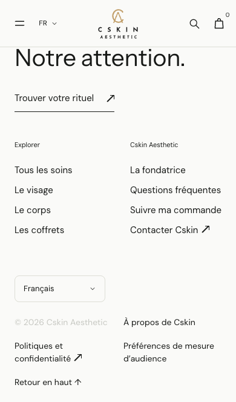
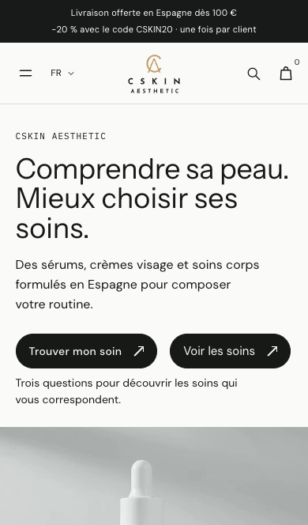
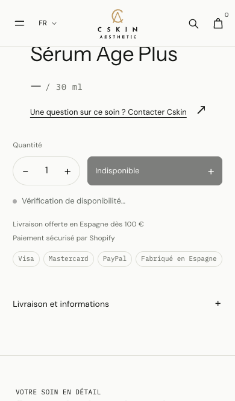
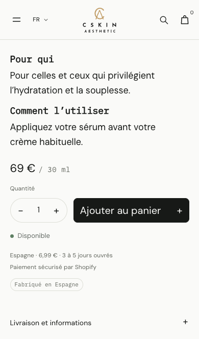

# Livraison de la branche SEO, Shopping et achat

## Prévisualisation

Depuis la racine du dépôt cloné, utiliser Node.js 22 ou plus récent.

```sh
node scripts/preview.mjs
```

Ouvrir http://localhost:4173/. Les pages produits, catégories et guides sont déjà générées dans `dist/`. Pour les régénérer après modification des données ou du modèle de cette branche, lancer `node scripts/generate-pages.mjs`. Le simulateur de prévisualisation sert une vraie page 404 pour les chemins inconnus et répond 308 pour compléter une barre oblique manquante. Sur GitHub Pages, le déploiement normal part d’un push sur `main`.

| Aperçus mobiles | Avant | Après |
| --- | --- | --- |
| Accueil |  |  |
| Achat du sérum |  |  |

[Résultat du questionnaire](captures/questionnaire-apres.png)

## Tests exécutés

- Vérification de syntaxe JavaScript, 34 tests du projet local et 3 tests du dépôt contrôlant les 72 pages et les alias. Depuis le dépôt cloné, lancer `node --test scripts/seo.test.mjs`.
- Chrome avec émulation iPhone 13. Accueil, questionnaire sans e-mail, recommandation, fiche, ajout, modification de quantité, retrait et passage en caisse simulée. Les trois langues, les fragments anciens, l’alias du sérum, les paramètres de campagne et les 404 sont contrôlés.
- Réponse Shopify simulée pour l’attente, la déconnexion et la rupture. Les événements analytiques sont interceptés avant envoi. Sans accord, aucun événement e-commerce. Avec accord, un ajout et un passage en caisse, y compris lors d’un double clic.
- Le test mobile rejouable s’exécute depuis le dépôt avec le serveur local actif, Chrome installé et Playwright disponible. Si installé ailleurs, indiquer le chemin de son dossier avec `CSKIN_PLAYWRIGHT`. Lancer `node scripts/verify-mobile.mjs`. Les captures vont dans le dossier temporaire système, ou celui défini avec `CSKIN_SCREENSHOT_DIR`.
- Caisse Shopify réelle ouverte séparément depuis FR, EN et ES. Le tarif et la remise ont été contrôlés avec une adresse à Madrid. La sélection de la France était indisponible. Les aperçus de confirmation et d’expédition ont été lus dans les trois langues.

## SEO et anciens liens

- Les 13 URL françaises de produit restent identiques. Les pages catégories, marque, contact, livraison, politiques et guides ont une URL accessible directement. Les versions EN et ES sont accessibles sous `/en/` et `/es/`. Le sitemap contient 72 URL. Chaque version a sa canonique propre et des liens hreflang réciproques, avec la version française comme valeur par défaut.
- Le HTML initial contient le titre de la page et du contenu utile avec des liens explorables, notamment les listes de produits dans les collections et les recommandations dans les guides. Les fiches ont un objet Product initial. L’offre est ajoutée après obtention du prix, de la devise et du stock Shopify. Les notes restent absentes des données structurées tant qu’aucune donnée publiée et vérifiée ne permet de les renseigner.
- Le 25 novembre, l’URL publique `/products/serum-age-plus-1` répondait 404, et `/produit/serum-age-plus-1/` 200. L’API Pages de GitHub confirme que le domaine public est servi par GitHub Pages. Les sitemaps Shopify et `collections.json` ont donné les 13 produits, `soins-visages-1`, `soins-corps`, `soins-nettoyants-visages` et `pages/la-marque`. Les variantes des mêmes chemins sous `/fr/`, `/en/` et `/es/` sont couvertes à titre de compatibilité. Les sitemaps Shopify explorés n’ont pas exposé de slugs traduits distincts.
- La branche embarque 84 routes de compatibilité HTML pour récupérer ces clics avec un lien et une redirection côté navigateur. Les paramètres de campagne sont conservés avec JavaScript. Les anciens fragments reconnus sont pris en charge côté navigateur. Une page HTML GitHub Pages ne peut pas renvoyer elle-même un statut HTTP 301 vers une autre destination. Pour les vraies 301, importer [la table des redirections](legacy-redirects.csv) dans la couche HTTP qui traitera les requêtes de `www.cskinaesthetic.com`. Par exemple, utiliser les règles de redirection du proxy ou CDN si la marque en choisit un, puis contrôler le code et l’en-tête Location depuis les URL publiques. Laisser les URL du sous-domaine de caisse à Shopify. Lire la [documentation Google sur les redirections](https://developers.google.com/search/docs/crawling-indexing/301-redirects) et [celle sur hreflang](https://developers.google.com/search/docs/specialty/international/localized-versions).
- **Search Console**. L’accès à la propriété HTTPS `www` a été confirmé. Le sitemap en production a été lu avec succès le 26 novembre et comporte 14 pages découvertes. Après une mise en ligne approuvée, actualiser le sitemap et inspecter le sérum, le duo, la mousse et au moins une variante par langue. Vérifier le choix de canonique, le HTML rendu et les rapports Extraits de produits / Fiches de marchand. Les 72 URL de la branche restent à explorer après publication.

## Vérifications Shopify et actions restantes

| Sujet | Vérification | Action avant ouverture du marché concerné |
| --- | --- | --- |
| Espagne | Seul marché actif. Option Estándar à 6,99 €, offerte à partir de 100 €, délai estimé de 3 à 5 jours ouvrés. À Madrid, caisse réelle ouverte pour un Sérum Age Plus à 69 €. Le tarif affiché était de 6,99 € et CSKIN20 a retiré 13,80 €, soit 62,19 € au total. | Vérifier séparément en caisse le seuil de gratuité avec un panier éligible et la règle après réduction avant d’afficher un montant restant dans le panier. L’adresse et les frais exacts sont confirmés au paiement. |
| France métropolitaine | La France n’apparaît pas dans le sélecteur de pays de la caisse. La Storefront API ne publie que ES. | Shopify → Marchés, créer ou activer un marché limité à la France métropolitaine, associer le catalogue et les prix EUR avec taxes applicables, vérifier les moyens de paiement disponibles et les domaines/langues. Dans Expédition, choisir l’emplacement et le profil de produits, la couverture par adresse/code postal, les tarifs, délais et éventuel seuil propres à la France. Tester sur une adresse métropolitaine, puis renseigner `CSKIN_DELIVERY.FR` après validation et synchroniser la politique du site. |
| Langues | Navigation et caisse atteintes depuis FR, EN et ES. Les trois liens de caisse aboutissent au français. Shopify → Langues affiche français publié, anglais et espagnol non publiés. Les descriptions Storefront reviennent en français pour FR, EN et ES. | Publier EN et ES sur Shopify, les associer aux marchés/domaines pertinents et vérifier les traductions des fiches et de la caisse. La navigation du site, les métadonnées et les guides disposent déjà des trois langues. |
| Sérum Age Plus | La source Shopify envoie encore la mention à retirer dans le même texte français pour les trois demandes de langue. Le rendu de cette branche et les données locales corrigent uniquement la formulation demandée. | Shopify → Produits → **Sérum Age Plus** (`serum-age-plus-1`, produit 10523242561883) → **Description**, ligne « Relaxant musculaire ». Supprimer la mention ciblée avant « pour lisser les rides d’expression ». Vérifier les mêmes champs de traduction dans Translate & Adapt, puis la description de la variante dans la source Merchant. |
| Confirmation de commande | Aperçus FR, EN et ES consultés. Ils contiennent la référence d’exemple #9999 et le bouton d’accès à la commande. | Vérifier le rendu réel lors d’une commande de test autorisée. |
| Confirmation d’expédition | Aperçus FR, EN et ES consultés. Ils contiennent un numéro de suivi d’exemple et le bouton de statut. Le transporteur UPS de l’aperçu est fictif. | Lors d’une commande de test Shopify, vérifier le lien Correos renseigné par le traitement et sa présence dans la notification. |
| Facture PDF | Un modèle de document « Facture » est visible dans Expédition et livraison. La notification « Facture de la commande » est également listée. | Vérifier la génération du PDF sur une commande de test ainsi que le mode d’accès client. Aucun PDF joint n’a été confirmé dans l’aperçu de confirmation de commande. |
| Rappel de paiement abandonné | L’écran des automatisations invite à installer Shopify Messaging. Aucun envoi automatisé propre au parcours Cskin n’a été vérifié. | Vérifier les rappels de caisse abandonnée dans le canal marketing ou dans les réglages de paiement de la boutique. Valider la restauration du panier avec un e-mail de test contrôlé, pour chaque langue publiée. |
| Paiements | La caisse Shopify a été ouverte jusqu’à l’affichage du total. L’admin Shopify affiche une demande de mise à jour des informations de l’entreprise liée aux paiements et aux versements. | Faire vérifier à la propriétaire le détail de la demande dans Shopify → Paramètres → Paiements, puis effectuer un test de paiement dans un environnement dédié. |

Aucun e-mail de test ni achat réel. Les aperçus Shopify servent à contrôler les modèles, et la caisse réelle a été quittée avant toute transaction.

## Merchant Center

Le canal Shopify Google & YouTube affiche 13 offres, 12 approuvées, 1 non approuvée, 0 limitée et 0 en examen. Son lien vers le compte Merchant Center renvoie 403 pour la session disponible. Le détail des recommandations, le produit refusé, les métriques Google et les champs actuellement transmis restent à relever dans le compte Merchant. Le score « Brillant » fourni pour l’Espagne décrit l’expérience agrégée de la boutique. Les impressions et clics se lisent dans le rapport Performance en filtrant le pays, la période et les fiches gratuites ou annonces selon le canal. Voir le [programme qualité Google](https://support.google.com/merchants/answer/14261098).

Les [13 offres Espagne](merchant/es-controle.csv) et les [13 offres à préparer pour la France](merchant/fr-controle.csv) sont des tableaux de rapprochement, à régénérer avec `node scripts/prepare-merchant.mjs`. Ils utilisent l’identifiant produit et variante Shopify, la destination proposée, le titre et le descriptif de la page, les photos vérifiées et les prix/stocks observés lorsque le marché est actif. Le fichier FR laisse le prix et le stock marché vides tant qu’ils ne peuvent pas être lus dans un marché FR actif. Ces fichiers s’ajoutent à la documentation de la branche, hors des fichiers servis par le site.

1. **Qualité boutique → Espagne → Voir 2 recommandations.** Relever les champs exacts et le motif de toute alerte. Dans **Produits → Action requise**, ouvrir l’offre non approuvée et relever le motif, la destination et la source.
2. **Produits → Sérum Age Plus → Données finales et source.** Rapprocher l’identifiant exact de l’offre et sa variante Shopify (10523242561883 / 53341609689435). Vérifier `link`, `description`, `image_link`, `additional_image_link`, `price` EUR, `availability`, `brand`, `condition`, codes GTIN/MPN quand réellement attribués et pays/langue. Remplacer un lien ancien par `/produit/serum-age-plus-1/` en FR ou `/es/produit/serum-age-plus-1/` en ES, selon la langue de l’offre. Appliquer le même contrôle aux autres lignes. Mettre à jour la source Shopify Google & YouTube ou, si le connecteur ne permet pas la correction du lien, utiliser une source supplémentaire compatible reliée à l’identifiant exact de l’offre. Vérifier que le domaine de destination est revendiqué dans le compte et que la source ne réintroduit pas les données anciennes. Voir les [attributs Merchant](https://support.google.com/merchants/answer/7052112?hl=fr).
3. **Images.** Shopify expose une photo principale pour chacun des trois produits prioritaires. Le [visuel du duo en main fourni par Cskin](https://www.cskinaesthetic.com/assets/campaign/day-night-hands.jpg) répond HTTP 200 et est préparé comme image secondaire du duo. Le sérum et la mousse restent à compléter avec une autre photo réelle validée du même produit. Contrôler le visuel, son URL et les dimensions. La variation de 1,17 à 1,09 par offre vient de la capture fournie. Voir [Image supplémentaire](https://support.google.com/merchants/answer/6324370?hl=fr).
4. **Livraison et retours.** Pour ES, renseigner le service Estándar, EUR, 6,99 €, gratuité à partir de 100 €, zone réellement desservie et délai de 3 à 5 jours ouvrés. Vérifier la répartition traitement/transit et l’heure limite avec Cskin avant de renseigner ces champs distincts. Le montant de 3,58 € est une suggestion de Google. Demander le coût Correos complet et la marge avant toute décision tarifaire. Pour les retours, vérifier le pays, l’URL `/livraison/`, le motif (changement d’avis ou produit défectueux), retour par courrier, frais directs à la charge de la cliente en cas de changement d’avis, remboursements et exceptions éventuelles. La politique distingue 14 jours après réception pour notifier la rétractation puis 14 jours pour expédier après la notification. Vérifier ce que le champ unique Merchant mesure avant de l’enregistrer. Ouvrir une configuration France séparée une fois les conditions et les tests validés. Voir [les champs de la politique de retour](https://support.google.com/merchants/answer/14011730?hl=fr).
5. **Avis marchands.** Vérifier le statut marchand dans Merchant Center. Les avis produits Judge.me sont déjà accessibles sur Cskin. Pour recueillir des avis sur la boutique, utiliser un dispositif post-achat après livraison, par exemple Google Avis clients si compatible avec le checkout Shopify, ou un partenaire d’avis marchands éligible. Tester le consentement et le lien avec un compte de test avant activation. Voir [Google Avis clients](https://support.google.com/merchants/answer/7124319?hl=fr).
